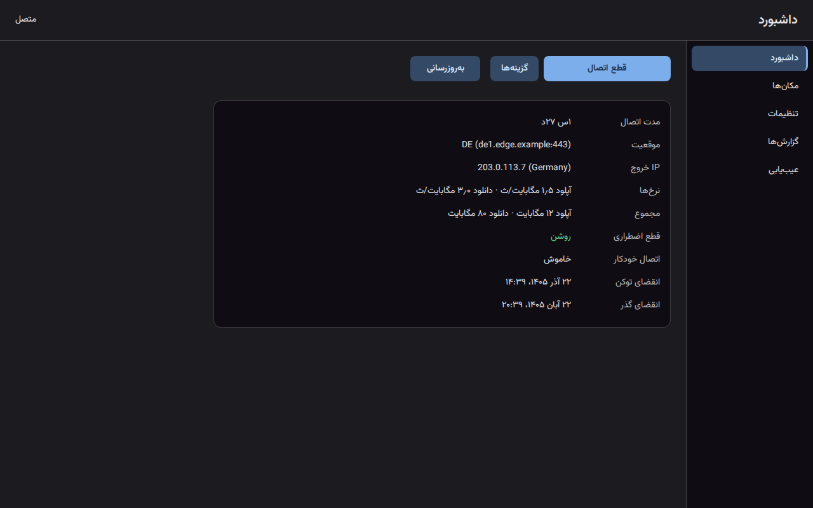
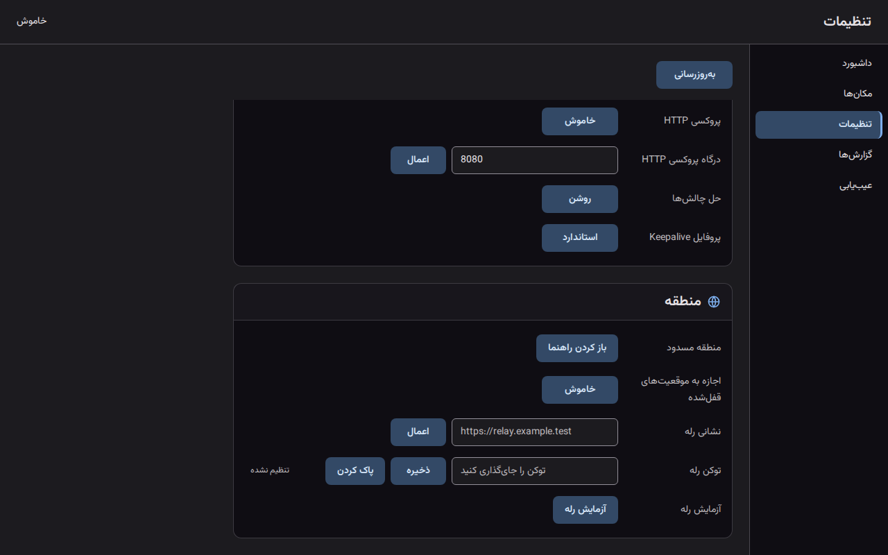
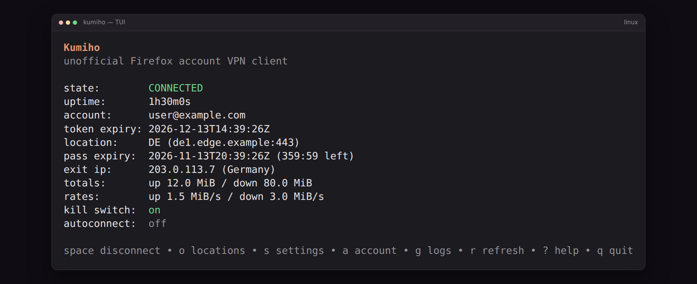
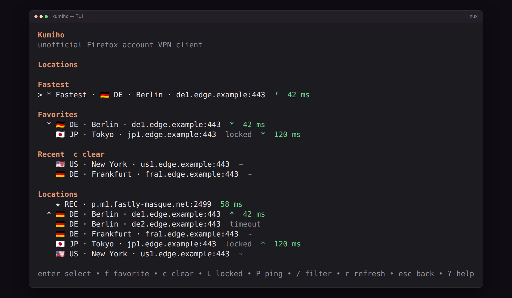
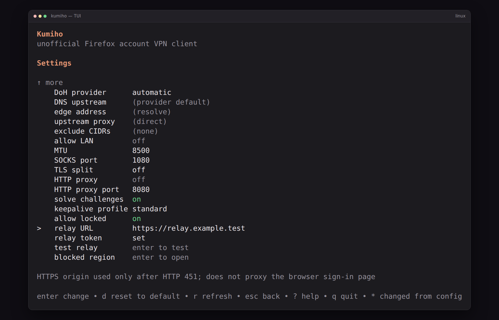
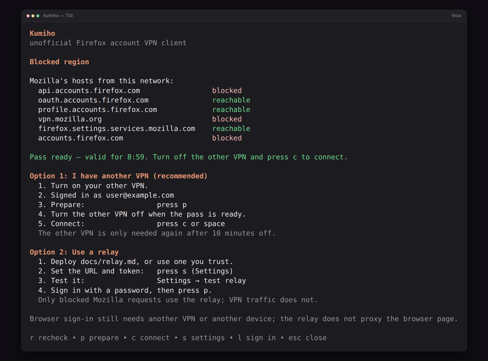
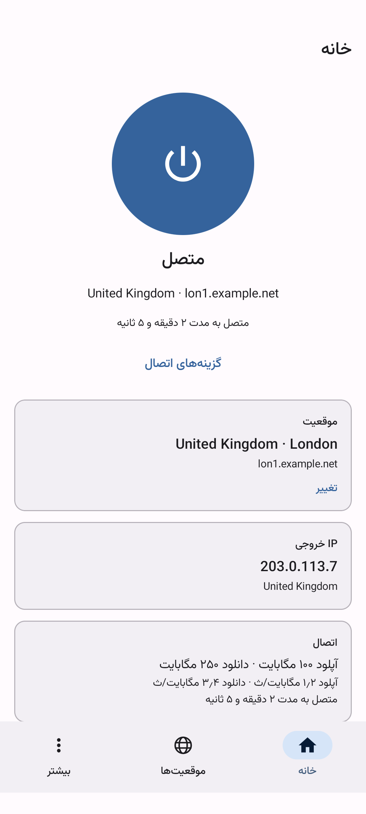
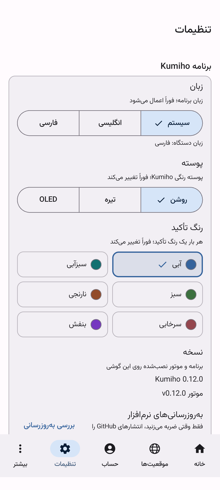
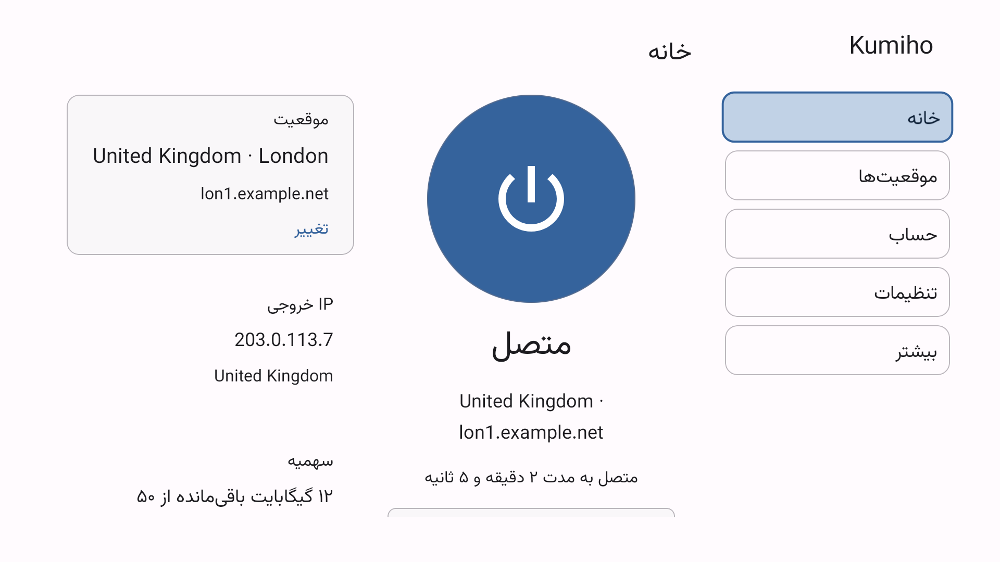

# Kumiho

[English](README.md) · [فارسی](README.fa.md)

Kumiho یک کلاینت غیررسمی برای VPN رایگان حساب Firefox است. از حساب Firefox
خودتان روی **Linux**، **Windows 11**، **گوشی Android** یا **Android TV** استفاده
کنید — با یک برنامهٔ بومی روی هر پلتفرم.

این یک تونل واقعی سیستم است، نه افزونهٔ مرورگر: یک دستگاه TUN در Linux یا
آداپتور Wintun در Windows همهٔ ترافیک را از طریق لبهٔ Fastly موزیلا با
HTTP/2 CONNECT عبور می‌دهد. Android همان موتور Go را در یک برنامهٔ `VpnService`
جاسازی می‌کند. Kumiho با حساب‌های Firefox (رمز یا مرورگر، سازگار با 2FA) وارد
می‌شود، نزدیک‌ترین سرور را پیدا می‌کند و تونل را با قطع اضطراری اختیاری زنده
نگه می‌دارد.

**وابسته به موزیلا نیست و مورد تأیید آن نیست.** [سلب مسئولیت](#سلب-مسئولیت) را
ببینید.

## دانلود

| پلتفرم | دانلود |
| --- | --- |
| Windows 11 (64-bit) |  |
| Linux (64-bit / ARM64) |   |
| گوشی Android و Android TV |    |

همهٔ فایل‌ها در
[SHA256SUMS-v0.13.0](https://github.com/benyamin-git/Kumiho/releases/download/v0.13.0/SHA256SUMS-v0.13.0)
فهرست شده‌اند. Android فقط به‌صورت نصب دستی (sideload) عرضه می‌شود؛ نسخه‌ای در
Play Store یا F-Droid وجود ندارد. نسخه‌های پیش‌انتشار v0.7.2 و پیش‌تر در
[صفحهٔ انتشارها](https://github.com/benyamin-git/Kumiho/releases) باقی می‌مانند.

## تصاویر

با دادهٔ نمونه گرفته شده‌اند: تصاویر Windows GUI در تم تیره و تصاویر
Android در تم روشن. تصاویر فارسی رابط، نسخهٔ راست‌به‌چپ را نشان
می‌دهند؛ TUI عمداً انگلیسی می‌ماند.

### Windows GUI

| داشبورد | تنظیمات |
| --- | --- |
|  |  |

### Linux TUI

| داشبورد | مکان‌ها |
| --- | --- |
|  |  |

### گوشی Android

| داشبورد | تنظیمات |
| --- | --- |
|  |  |

### Android TV

| خانه |
| --- |
|  |

## تازه‌های نسخهٔ 0.13.0

- **حساب‌ها در تنظیمات** — رابط گرافیکی Windows و برنامهٔ Android (گوشی و TV)
  اکنون فهرست حساب‌ها، افزودن حساب، ورود دوباره و خروج سراسری را در بالای
  تنظیمات مدیریت می‌کنند؛ صفحهٔ جداگانهٔ حساب حذف شده است.
- **مکان‌ها و تنظیمات ساده‌تر** — فهرست تخت سرورها با جستجوی فشرده، پرچم‌های
  واقعی بزرگ‌تر و سرصفحه‌ها و نمادهای گروه‌های تنظیمات؛ کارت سهمیه و بخش‌های
  موارد دلخواه و اخیر حذف شده‌اند.

تغییرات کامل در [تاریخچهٔ تغییرات](CHANGELOG.md) آمده است.

## نصب

### Linux

یک فرمان روی Ubuntu 24.04 amd64 یا arm64. آخرین انتشار منتشرشده را دانلود
می‌کند، `SHA256SUMS` را بررسی می‌کند و نصب‌کنندهٔ همراه را اجرا می‌کند:

    curl -fsSL https://raw.githubusercontent.com/benyamin-git/Kumiho/main/scripts/install-release.sh | sudo bash

سپس وارد شوید و TUI را شروع کنید:

    kumiho login
    kumiho

برای نصب از بستهٔ دانلودشده، آن را استخراج کنید و اجرا کنید:

    sudo ./install.sh

نصب‌کننده دیمن، واحد systemd و CLI/TUI را اضافه می‌کند. Kumiho به‌عنوان سرویس
سیستم اجرا می‌شود، بنابراین تونل پس از خروج از SSH هم باقی می‌ماند. برای نسخهٔ
مشخص، به‌روزرسانی و حذف، [راهنمای نصب Linux](docs/install.md) را ببینید.

### Windows 11

1. فایل `Kumiho-Windows-amd64.zip` را دانلود و استخراج کنید.
2. در **PowerShell با دسترسی Administrator**، `.\install.ps1` را اجرا کنید (یا
   روی `install.cmd` دوبار کلیک کنید).
3. **Kumiho** را از منوی Start اجرا کنید.

نصب‌کننده CLI، رابط گرافیکی Windows و `wintun.dll` را اضافه می‌کند، سرویس را
نصب می‌کند و برنامه را هنگام ورود باز می‌کند. برنامه به WebView2 Runtime نیاز
دارد که همراه Windows 11 عرضه می‌شود.

[راهنمای نصب Windows](docs/install.md#windows-11) و
[راهنمای GUI](docs/gui.md) را ببینید.

### Android

APK مناسب دستگاه خود را دانلود و باز کنید. وقتی Android پرسید، نصب از
فایل‌منیجر یا مرورگر را مجاز کنید؛ Kumiho فقط به‌صورت sideload عرضه می‌شود.

- **بیشتر گوشی‌ها و Android TV:** `Kumiho-Android-arm64-v8a.apk`
- **گوشی‌های ۳۲بیتی قدیمی‌تر:** `Kumiho-Android-armeabi-v7a.apk`
- **اگر مطمئن نیستید:** `Kumiho-Android-universal.apk`

اجرای نخست، ورود به حساب Firefox، مجوز VPN و راهنمای باتری/Always-on را طی
می‌کند. روی Android TV همان APK پوستهٔ TV را باز می‌کند. [راهنمای Android](docs/android.md)
و [راهنمای Android TV](docs/android-tv.md) را ببینید.

## امکانات

- **حساب Firefox شما** — ورود با رمز یا مرورگر، 2FA، حداکثر پنج حساب با
  برچسب و خروج سراسری از حساب‌ها.
- **عبور از چالش لبهٔ موزیلا** — چالش Fastly حل و درخواست دوباره ارسال
  می‌شود؛ اگر چالش همچنان API رمز را مسدود کند، همان ورود در مرورگر ادامه
  می‌یابد و به بن‌بست نمی‌رسد.
- **راه‌اندازی نخست در منطقهٔ مسدود** — خطای HTTP 451 صادقانه گزارش می‌شود و
  راهنمای قابل استفادهٔ **منطقهٔ مسدود** یک بار ورود از طریق VPN دیگر، آماده‌سازی
  گذر و سپس تمدید از تونل خود Kumiho را نشان می‌دهد. رلهٔ کاربر همچنان
  جایگزین است و هرگز ترافیک VPN یا صفحهٔ ورود مرورگر را حمل نمی‌کند.
  [راهنمای رله](docs/relay.md) را ببینید.
- **تونل واقعی سیستم** — TUN در Linux، Wintun در Windows و `VpnService` در
  Android؛ قطع اضطراری اختیاری، تونل‌شکنی در Android و پروکسی محلی SOCKS5 روی
  هر پلتفرم.
- **مکان‌هایی که معنا دارند** — یک فهرست تخت از سرورها با پرچم واقعی کشور،
  جستجو، پینگ واقعی لبه و سریع‌ترین؛ ردیف‌های قفل‌شده تا وقتی آن‌ها را نمایش
  ندهید پنهان می‌مانند.
- **DNS سخت‌گیرانه** — DNS over HTTPS داخل تونل، با جایگزینی Cloudflare و
  Quad9؛ بدون بازگشت به DNS متن‌باز.
- **راحتی دسکتاپ** — سرویس systemd یا Windows، یک TUI و CLI با Bubble Tea و
  رابط گرافیکی بومی Windows با tray، گزارش‌ها و عیب‌یابی.
- **Android در همه‌جا** — پوستهٔ گوشی و TV، ویجت‌های صفحهٔ خانه، کاشی تنظیمات
  سریع، اعلان وضعیت، اشتراک‌گذاری گزارش‌ها و عیب‌یابی.

## مستندات

- [راهنمای ساده](docs/manual.md) — نسخهٔ یک‌صفحه‌ای.
- [CLI و TUI](docs/usage.md) — فرمان‌ها، کلیدها و همهٔ تنظیمات.
- [رلهٔ صفحهٔ کنترل](docs/relay.md) — استقرار Worker، تنظیم توکن، آزمایش و
  محدودیت‌ها.
- [نصب Linux](docs/install.md) · [رابط Windows](docs/gui.md) ·
  [Android](docs/android.md) · [Android TV](docs/android-tv.md)
- [عیب‌یابی](docs/troubleshooting.md)
- [توسعه](docs/development.md) — ساخت، آزمون، انتشار و معماری.
- [طراحی کامل و پروتکل](PLAN.md) · [تاریخچهٔ تغییرات](CHANGELOG.md)

## محدودیت‌های شناخته‌شده

- UDP غیر DNS (QUIC/HTTP3، VoIP، بازی‌ها) عمداً داخل تونل مسدود می‌شود؛
  برنامه‌ها به TCP بازمی‌گردند.
- جریان رمز نمی‌تواند کپچای تعاملی را حل کند. وقتی موزیلا کپچا می‌خواهد از
  ورود مرورگری استفاده کنید.
- فایل اجرایی Windows امضا نشده است، بنابراین SmartScreen در اجرای نخست
  هشدار می‌دهد.
- Android IPv6 را می‌گیرد و blackhole می‌کند، نه تونل. به‌روزرسانی Android
  فقط پس از تأیید شما در نصب‌کنندهٔ سیستم انجام می‌شود و کانال فروشگاهی برای
  به‌روزرسانی وجود ندارد.
- استفاده از یک کلاینت غیررسمی طبق شرایط سرویس Mozilla در منطقهٔ خاکستری است.
  چرخش حساب اختیاری است و به‌طور پیش‌فرض خاموش می‌ماند.

## سلب مسئولیت

Kumiho غیررسمی است و وابسته به موزیلا یا مورد تأیید آن نیست. از حق اشتراک حساب
Firefox خودتان استفاده می‌کند. پیش از سپردن اعتبارنامه‌ها به آن، کد را بررسی
کنید. Kumiho هرگز رمز Firefox شما را نمی‌بیند یا ذخیره نمی‌کند؛ توکن‌های OAuth
حاصل را به‌صورت محلی نگه می‌دارد.

## تقدیرها

[NOTICE](NOTICE) را ببینید. مرجع رفتار پروتکل: FoxyVPN (MIT).

---

**نگهداری:** انگلیسی منبع اصلی است. این فایل فارسی همراه هر انتشار کاربری
به‌روزرسانی می‌شود؛ اگر ترجمه با انگلیسی اختلاف داشت، نسخهٔ انگلیسی معتبر است.

