# Kumiho

Kumiho is an unofficial desktop and mobile client for the free
Firefox-account VPN. Use your own Firefox account on **Linux**, **Windows 11**,
**Android phones** or **Android TV** — with a native app on every platform.

It is a real system tunnel, not a browser extension: a Linux TUN device or a
Windows Wintun adapter carries all traffic through Mozilla's Fastly edge over
HTTP/2 CONNECT. Android embeds the same Go engine in a `VpnService` app.
Kumiho signs in with Firefox Accounts (password or browser, 2FA aware), finds
the nearest server, and keeps the tunnel alive with an optional kill switch.

**Not affiliated with or endorsed by Mozilla.** See the
[disclaimer](#disclaimer).

## Download

| Platform | Download |
| --- | --- |
| Windows 11 (64-bit) | [Kumiho-Windows-amd64.zip](https://github.com/benyamin-git/Kumiho/releases/latest/download/Kumiho-Windows-amd64.zip) |
| Linux (64-bit) | [Kumiho-Linux-amd64.zip](https://github.com/benyamin-git/Kumiho/releases/latest/download/Kumiho-Linux-amd64.zip) |
| Linux (ARM64) | [Kumiho-Linux-arm64.zip](https://github.com/benyamin-git/Kumiho/releases/latest/download/Kumiho-Linux-arm64.zip) |
| Android phone/TV (arm64-v8a) | [Kumiho-Android-arm64-v8a.apk](https://github.com/benyamin-git/Kumiho/releases/latest/download/Kumiho-Android-arm64-v8a.apk) |
| Android (armeabi-v7a) | [Kumiho-Android-armeabi-v7a.apk](https://github.com/benyamin-git/Kumiho/releases/latest/download/Kumiho-Android-armeabi-v7a.apk) |
| Android (universal) | [Kumiho-Android-universal.apk](https://github.com/benyamin-git/Kumiho/releases/latest/download/Kumiho-Android-universal.apk) |

Every file is listed in
[SHA256SUMS](https://github.com/benyamin-git/Kumiho/releases/latest/download/SHA256SUMS).
Android is sideload-only: there is no Play Store or F-Droid build. These links
follow the latest full release; v0.7.2 and earlier prereleases remain on the
[releases page](https://github.com/benyamin-git/Kumiho/releases).

## Screenshots

Captured in the Dark theme with sample data.

### Windows GUI

| Dashboard | Locations |
| --- | --- |
| 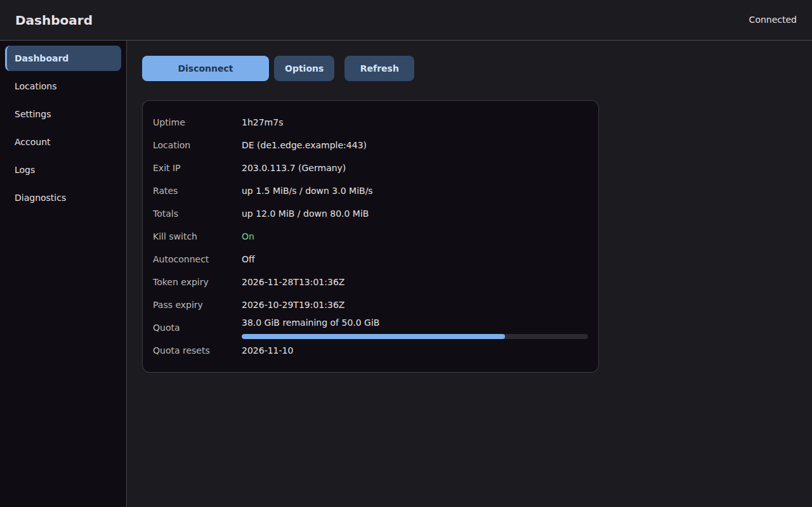 | 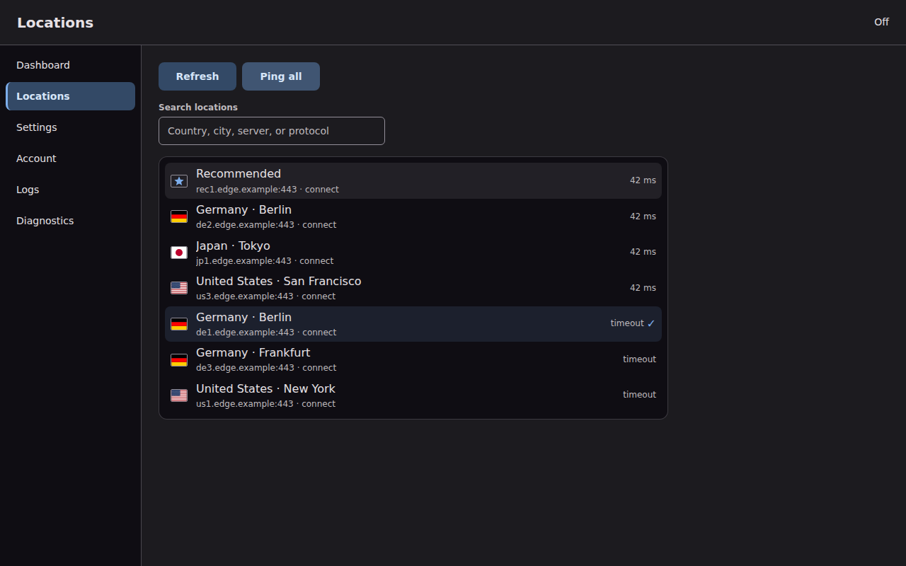 |

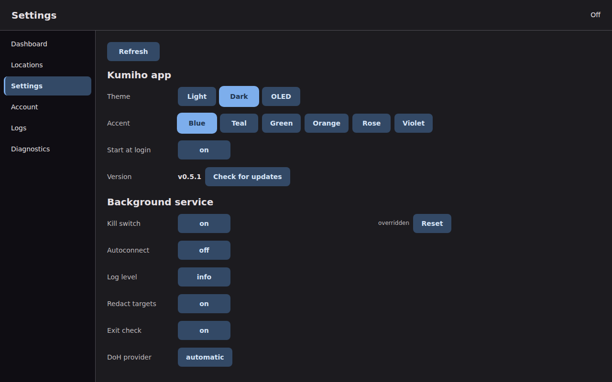

### Linux TUI

| Dashboard | Locations |
| --- | --- |
| 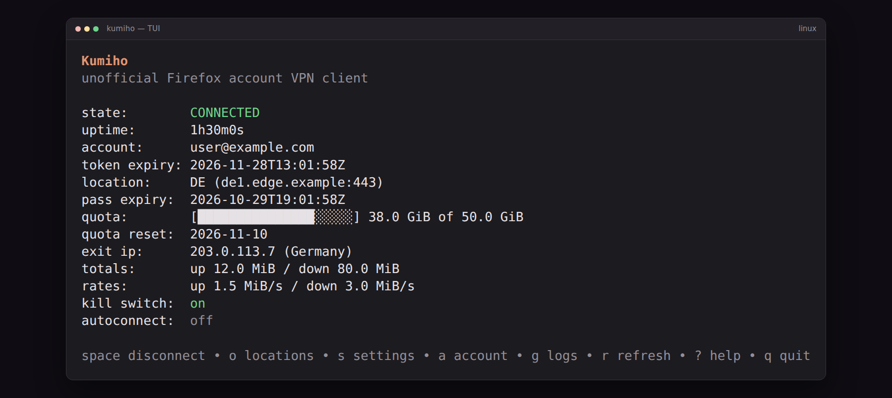 | 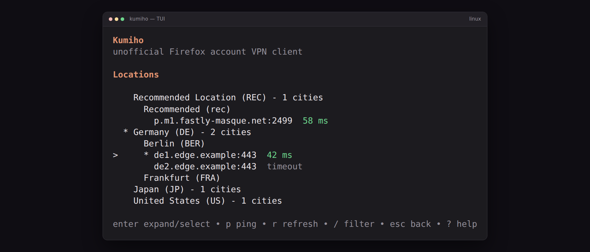 |

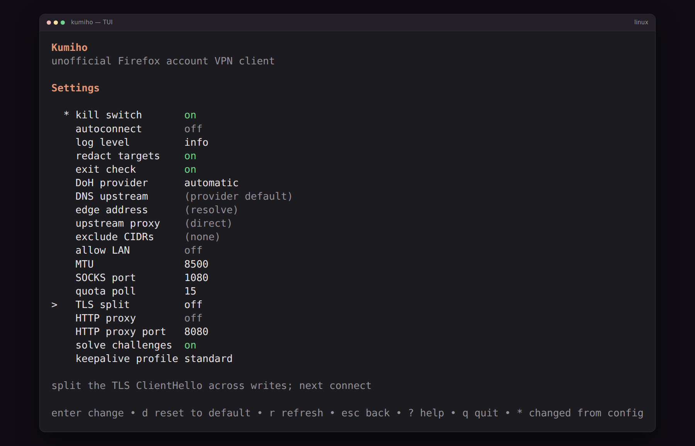

### Android phone

| Dashboard | Locations | Settings |
| --- | --- | --- |
| 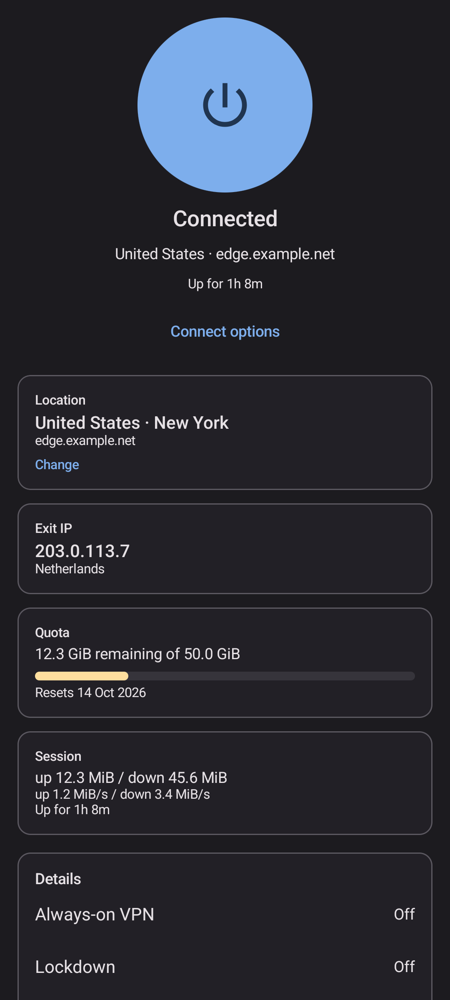 | 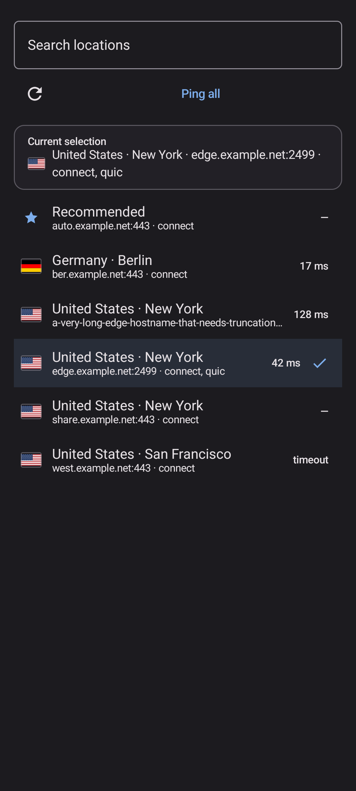 | 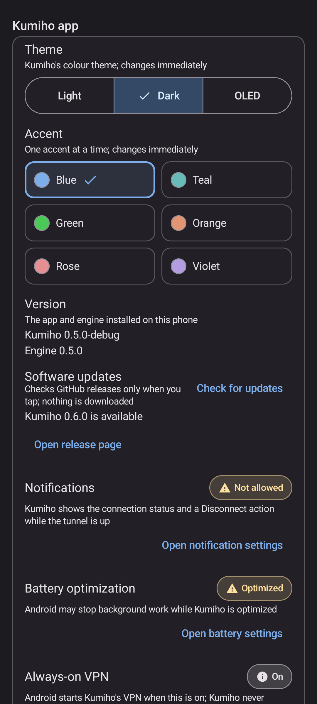 |

### Android TV

| Home | Locations | Settings |
| --- | --- | --- |
| 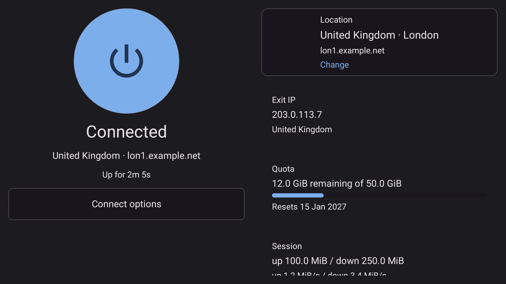 | 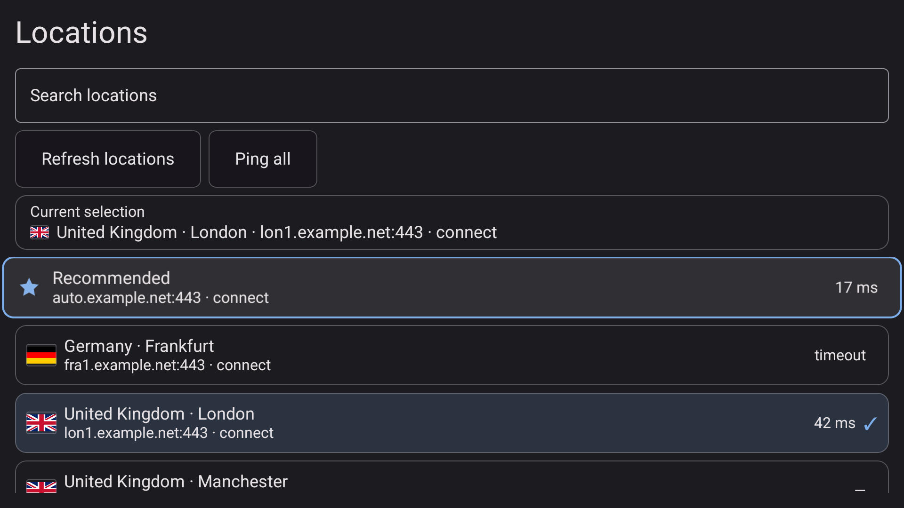 | 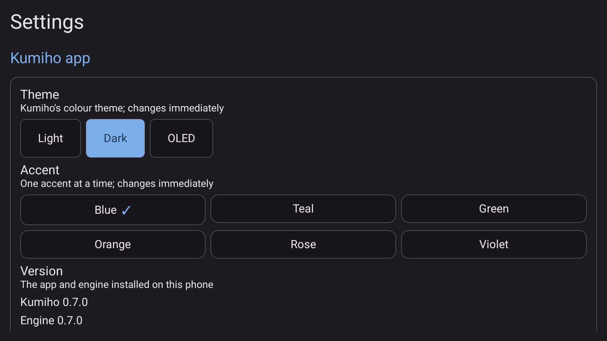 |

## What's new in v0.8.1

- **The keyboard no longer hides the page** — on Android, opening the on-screen
  keyboard in Locations search or the Account email/password form used to
  collapse the page to its background. The content now stays in view above the
  keyboard.

**Known issue:** adding an account with **Continue in browser** still fails
with Mozilla's *Invalid Query Parameters* page. Use password sign-in for now;
the browser flow is the next fix.

Older changes are in the [changelog](CHANGELOG.md).

## Install

### Linux

One command on Ubuntu 24.04 amd64 or arm64. It downloads the newest published
release, verifies the release `SHA256SUMS`, and runs the bundled installer:

    curl -fsSL https://raw.githubusercontent.com/benyamin-git/Kumiho/main/scripts/install-release.sh | sudo bash

Then sign in and start the TUI:

    kumiho login
    kumiho

To install from a downloaded archive instead, extract it and run:

    sudo ./install.sh

The installer adds the daemon, the systemd unit and the CLI/TUI. Kumiho runs
as a system service, so the tunnel survives SSH logouts. See the
[Linux install guide](docs/install.md) for a specific version, upgrade and
uninstall.

### Windows 11

1. Download `Kumiho-Windows-amd64.zip` and extract it.
2. In **Administrator PowerShell**, run `.\install.ps1` (or double-click
   `install.cmd`).
3. Start **Kumiho** from the Start Menu.

The installer adds the CLI, the Windows GUI and `wintun.dll`, installs the
service and opens the app at login. The app needs the WebView2 Runtime, which
ships with Windows 11.

See the [Windows install guide](docs/install.md#windows-11) and the
[GUI guide](docs/gui.md).

### Android

Download the APK for your device and open it. Allow installation from your
file manager or browser when Android asks; Kumiho is sideload-only.

- **Most phones and Android TV:** `Kumiho-Android-arm64-v8a.apk`
- **Older 32-bit phones:** `Kumiho-Android-armeabi-v7a.apk`
- **Not sure:** `Kumiho-Android-universal.apk`

The first launch walks through Firefox Accounts sign-in, VPN permission and
battery/Always-on guidance. On Android TV the same APK opens the TV shell. See
the [Android guide](docs/android.md) and [Android TV guide](docs/android-tv.md).

## Features

- **Your Firefox account** — password or browser sign-in, 2FA, up to five
  accounts with labels, quota rotation and a session-wide sign-out.
- **Mozilla's edge challenge handled** — solves the Fastly challenge and
  retries a blocked auth host, so password sign-in works on restrictive
  networks.
- **Real system tunnel** — TUN on Linux, Wintun on Windows and `VpnService` on
  Android; optional kill switch, split tunneling on Android, and a local SOCKS5
  proxy on every platform.
- **Locations that make sense** — one flat server list with real country flags,
  search, Ping all and measured latency.
- **Strict DNS** — DNS over HTTPS inside the tunnel, with Cloudflare and Quad9
  failover; no plaintext fallback.
- **Desktop comfort** — systemd or Windows service, a Bubble Tea TUI and CLI,
  and a native Windows GUI with tray, logs and diagnostics.
- **Android everywhere** — phone and TV shells, Quick Settings tile, status
  notification, logs sharing and diagnostics.

## Documentation

- [Simple manual](docs/manual.md) — the one-screen version.
- [CLI and TUI](docs/usage.md) — commands, keys and every setting.
- [Linux install](docs/install.md) · [Windows GUI](docs/gui.md) ·
  [Android](docs/android.md) · [Android TV](docs/android-tv.md)
- [Troubleshooting](docs/troubleshooting.md)
- [Development](docs/development.md) — build, test, release and architecture.
- [Full design and protocol](PLAN.md) · [Changelog](CHANGELOG.md)

## Known limitations

- Non-DNS UDP (QUIC/HTTP3, VoIP, games) is intentionally blocked inside the
  tunnel; applications fall back to TCP.
- The password flow cannot solve an interactive captcha. Use browser sign-in
  when Mozilla asks for one.
- The Windows binary is unsigned, so SmartScreen warns on first run.
- Android captures and blackholes IPv6 instead of tunneling it, and there is
  no in-app APK installer or auto-update.
- Using an unofficial client is a ToS gray area. Account rotation is opt-in and
  off by default.

## Disclaimer

Kumiho is unofficial and is not affiliated with or endorsed by Mozilla. It uses
your own Firefox account entitlement. Review the code before trusting it with
your credentials. Kumiho never sees or stores your Firefox password; it stores
the resulting OAuth tokens locally.

## Attribution

See [NOTICE](NOTICE). Protocol behavior reference: FoxyVPN (MIT).
